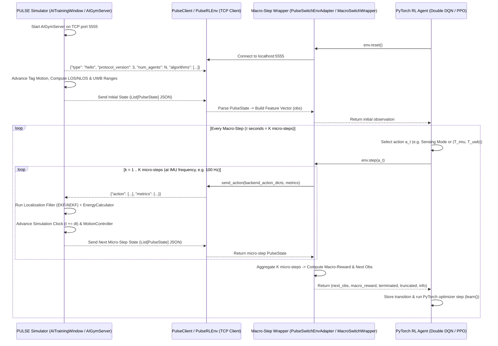

# PULSE AI Training Architecture, Simulator Control & PyTorch Agent Logic

This document preserves the complete design, mathematical formulations, communication protocol, simulator control logic, and PyTorch Reinforcement Learning (RL) agent implementations for training adaptive UWB–IMU localization agents in the **PULSE Simulator**.

---

## 1. System Architecture & Connection Flow

The AI training system separates the **Simulator & Visualization Server** (inside the PULSE PyQt5 GUI or headless worker) from the **External AI Client / PyTorch Agent** over a bidirectional TCP socket (Protocol v3, default port `5555`).



### Preserved API Components
- **Simulator-Side Window & API**:
  - `src/gui/windows/ai_training_window.py` (`AITrainingWindow`): Interactive GUI window that steps `N` independent agents, visualizes trajectories, anchor selections, error, rewards, and cumulative energy, and communicates with the RL agent.
  - `src/api/ai_gym_server.py` (`AIGymServer`): Thread-safe TCP server implementing Protocol v3 (`hello` handshake, queue-based action mailbox, `reset` command acknowledgement, disconnect sentinels).
  - `src/api/ai_training_facade.py` (`AITrainingAPI`): Scoped facade that builds the enriched per-step observation dictionary (`build_step_observation`) using `EnergyDataAdapter`, `FilterDataAdapter`, `ChannelDataAdapter`, and `GeometryDataAdapter`.
- **Client-Side SDK (`external_ai_client/pulse_ai_client/`)**:
  - `PulseClient` (`client.py`): Low-level TCP socket client handling the v3 handshake, `receive_state()`, `send_action(action, metrics)`, and `reset()`.
  - `PulseRLEnv` (`env.py`): OpenAI Gymnasium (`gym.Env`) wrapper around `PulseClient` with customizable `action_formatter`, `obs_formatter`, and `reward_formatter`.
  - `PulseState` (`state.py`): Typed dataclass hierarchy (`MeasurementData`, `IMUData`, `NLOSInfo`, `AlgorithmInfo`, `PrecisionInfo`, `EnergyInfo`, `EnvironmentConfig`, `DutyCycleInfo`) parsed from the server's JSON payload.

---

## 2. How the Simulator is Controlled (`AITrainingWindow` & Protocol v3)

### 2.1 Simulator Step Loop (`AITrainingWindow.environment_step`)
Each tick of `AITrainingWindow` executes a 4-stage state machine for `num_agents` independent tags:

1. **Advance Motion & Send Enriched State**:
   - Advances each agent's `Tag` along the active trajectory (`MotionController.update_tag_position`), generating true position, velocity, acceleration, orientation, and simulated 3D IMU readings (`acc_x, acc_y, acc_z`, `gyro_x, gyro_y, gyro_z`).
   - Performs a GPU/CPU batch LOS/NLOS check against all NLOS zones (`channel_model.batch_update_los_conditions`) and samples noisy UWB distance measurements (`channel_model.measure_distance`).
   - Calls `AITrainingAPI.build_step_observation(...)` to package ground-truth position, estimated position, UWB ranges, LOS flags, IMU data, GDOP, localization error, step/cumulative energy, and duty-cycle state (`t_imu`, `t_uwb`, `cycle_time`, `uwb_window_open`).
   - Sends the JSON list of agent states over `AIGymServer.send_state(all_states)`.
2. **Wait for Agent Action**:
   - Polls `self.server.wait_for_action(timeout=0.01)` non-blockingly so the Qt GUI stays responsive.
3. **Apply Action & Update Filter + Energy**:
   - Unpacks the action dictionary for each agent `a_idx` and executes the selected localization algorithm (`BaseLocalizationAlgorithm.update(AlgorithmInput)`):
     - Filters UWB measurements to only the agent-selected anchor indices (`"anchors"`).
     - Enables/disables IMU inputs based on `"measurement_source"` (`"imu"`, `"uwb"`, or `"both"`).
     - If the algorithm supports duty-cycling (`hasattr(algo_instance, 'set_duty_cycle')`, e.g., `"Duty-Cycled UWB-IMU NA-AEKF"`), applies `"t_imu"` and `"t_uwb"` via:
       ```python
       algo_instance.set_duty_cycle(
           cycle_length=t_imu_val + t_uwb_val,
           active_window=t_uwb_val,
       )
       ```
   - Computes step energy consumption ($\mu\text{J}$) via `EnergyCalculator.calculate_step(dt)` based on the number of active anchors, IMU state, and whether the UWB window is open (`extra["uwb_window_open"]`).
   - Updates live metrics plots (Localization Error, Resource Usage Timeline, Step/Cumulative Reward, Cumulative Energy vs. `IMU Only` and `UWB Always` baselines).
4. **Advance Simulation Clock**:
   - Increments `current_step += 1` and `agent_sim_times[i] += dt`.

### 2.2 Action Payload Format Sent by the Agent
The client sends newline-delimited JSON frames to `AIGymServer`:

```json
{
  "action": [
    {
      "filter": "Duty-Cycled UWB-IMU NA-AEKF",
      "measurement_source": "both",
      "anchors": [0, 1, 2, 3, 4, 5, 6, 7],
      "t_imu": 0.5,
      "t_uwb": 0.1
    }
  ],
  "metrics": {
    "step_rewards": [0.85],
    "cumulative_rewards": [42.3],
    "nn_inference_time": 0.0004,
    "optimizer_time": 0.0012
  }
}
```

- **`filter`**: Name of any registered algorithm in `Alghortimes_doc` (default: `"Duty-Cycled UWB-IMU NA-AEKF"`).
- **`measurement_source`**: `"imu"` (IMU dead-reckoning only), `"uwb"` (UWB ranging only), or `"both"` (UWB+IMU fusion).
- **`anchors`**: List of integer indices of active UWB anchors.
- **`t_imu` / `t_uwb`**: Duration (seconds) of the IMU-only phase and active UWB fusion window for duty-cycled filters.
- **`metrics`**: Optional dictionary allowing the external PyTorch script to stream its own computed rewards and timing telemetry directly onto the PULSE GUI plots.

---

## 3. Environment Control Wrappers (Macro-Stepping & Reward Logic)

Because physical simulation runs at a high micro-step rate (e.g., $\Delta t = 5\text{--}10\,\text{ms}$, $f_{\text{IMU}} = 100\,\text{Hz}$), making RL decisions at every single micro-step causes excessive switching and communication overhead. Two macro-step Gymnasium wrappers were designed to bridge `PulseRLEnv` and PyTorch agents:

### 3.1 Mode Switching Wrapper (`PulseSwitchEnvAdapter`)
Controls **3 discrete conceptual sensing modes** over a fixed macro-step window $\tau$ (e.g., $\tau = 0.5\,\text{s}$, $N_{\text{sub}} = \tau \cdot f_{\text{IMU}} = 50$ micro-steps):

- **Action Space (`Discrete(3)`)**:
  - `0` (**`IMU_ONLY`**): `measurement_source = "imu"`, `t_imu = tau`, `t_uwb = 0.0` (lowest power $\approx 3.3\,\text{mW}$, accumulates dead-reckoning drift).
  - `1` (**`UWB_ONLY`**): `measurement_source = "uwb"`, `t_imu = 0.0`, `t_uwb = tau` (high power, no IMU aiding).
  - `2` (**`FUSION`**): `measurement_source = "both"`, `t_imu = 0.0`, `t_uwb = tau` (highest accuracy, highest power $\approx 45\,\text{mW}$).
- **12-Dimensional Observation Vector (`obs_dim = 12`)**:
  $$\mathbf{o}_t = \big[\, e_t,\; \Delta e_t,\; a_x, a_y, a_z,\; \omega_x, \omega_y, \omega_z,\; \text{GDOP},\; f_{\text{NLOS}},\; m_{t-1},\; \hat{E}_{t-1} \,\big]^\top$$
  where:
  - $e_t$: Current localization error (m)
  - $\Delta e_t = e_t - e_{t-1}$: Error trend over the last macro-step
  - $(a_x, a_y, a_z)$ and $(\omega_x, \omega_y, \omega_z)$: 3D accelerometer ($\text{m/s}^2$) and gyroscope ($\text{rad/s}$) readings
  - $\text{GDOP}$: Geometric Dilution of Precision
  - $f_{\text{NLOS}} = \min(1.0, N_{\text{NLOS}} / N_{\text{anchors}})$: Fraction of anchors in NLOS
  - $m_{t-1} \in \{0, 1, 2\}$: Previously active sensing mode
  - $\hat{E}_{t-1} = \min(1.0, E_{t-1} / 50000\,\mu\text{J})$: Normalized energy consumed in the previous macro-step
- **Multi-Objective & Constrained Reward (`StandardRewardCalculator`)**:
  Let $\bar{e}_t$ be the mean localization error (m) and $E_t$ the total energy ($\mu\text{J}$) across the macro-step:
  - Normalized error: $\hat{e}_t = \min(\bar{e}_t / e_{\max}, 5.0)$ with $e_{\max} = 2.0\,\text{m}$
  - Normalized energy: $\hat{\mathcal{E}}_t = \min(E_t / E_{\max}, 2.0)$ with $E_{\max} = 50000\,\mu\text{J}$
  - Accuracy target violation ($e_{\text{target}} = 0.20\,\text{m}$):
    $$v_t = \mathbb{I}(\bar{e}_t > e_{\text{target}}), \qquad \delta_t = \max(0, \bar{e}_t - e_{\text{target}})$$
  - **Weighted formulation**:
    $$R_t = -\alpha_{\text{err}} \hat{e}_t - \beta_{\text{eng}} \hat{\mathcal{E}}_t - \gamma_{\text{viol}} (v_t \cdot \delta_t)$$
  - **Constrained formulation**:
    $$R_t = -\beta_{\text{eng}} \hat{\mathcal{E}}_t - v_t \cdot \big(\gamma_{\text{viol}} + s_{\text{viol}} \cdot \delta_t\big)$$

### 3.2 Dynamic Duty-Cycle Timing Wrapper (`MacroSwitchWrapper`)
Directly controls the **IMU sleep window $T_{\text{imu}}$ and UWB active fusion window $T_{\text{fusion}}$** of the `"Duty-Cycled UWB-IMU NA-AEKF"` algorithm:

- **Action Space (`MultiDiscrete([72] * num_agents)`)**:
  - $T_{\text{imu}} \in \{0.1, 0.2, 0.3, 0.4, 0.5, 0.75, 1.0, 1.5, 2.0\}\,\text{s}$ (9 choices)
  - $T_{\text{fusion}} \in \{0.05, 0.1, 0.2, 0.3, 0.4, 0.5, 0.75, 1.0\}\,\text{s}$ (8 choices)
  - Action index $a \in \{0, \dots, 71\}$ decodes to:
    ```python
    imu_idx = act // len(t_fusion_choices)
    fusion_idx = act % len(t_fusion_choices)
    t_imu = t_imu_choices[imu_idx]
    t_fusion = t_fusion_choices[fusion_idx]
    ```
  - Macro-step duration dynamically adapts to $\tau = \max_i (T_{\text{imu},i} + T_{\text{fusion},i})$ so every agent completes at least one full duty cycle before the next decision.
- **Discrete/Continuous Multi-Objective Macro-Reward**:
  $$R_t = W_{\text{ERROR}} \cdot r_{\text{mean}} + W_{\text{STD}} \cdot r_{\text{std}} + W_{\text{ENERGY}} \cdot r_{\text{energy}}$$
  with $W_{\text{ERROR}} = 1.0, W_{\text{STD}} = 0.5, W_{\text{ENERGY}} = 1.0$, target mean $e_{\text{target}} = 0.20\,\text{m}$, target std $\sigma_{\text{target}} = 0.15\,\text{m}$:
  - $r_{\text{mean}} = 1.0$ if $\bar{e}_t \le e_{\text{target}}$, else $\max\!\big(-1.0,\; 1.0 - \frac{\bar{e}_t - e_{\text{target}}}{e_{\text{target}}}\big)$
  - $r_{\text{std}} = 1.0$ if $\sigma_e \le \sigma_{\text{target}}$, else $\max\!\big(-1.0,\; 1.0 - \frac{\sigma_e - \sigma_{\text{target}}}{\sigma_{\text{target}}}\big)$
  - $r_{\text{energy}} = +1$ if $E_t < E_{t-1}$, $-1$ if $E_t > E_{t-1}$, and $0$ otherwise.

---

## 4. PyTorch RL Agent Architectures & Reference Implementation

### 4.1 Double Deep Q-Network (Double DQN) in PyTorch
Uses a compact MLP Q-network (`obs_dim -> 64 -> 64 -> action_dim`), a fixed-capacity circular experience replay buffer, Huber (`SmoothL1Loss`) loss, gradient clipping (`max_norm = 1.0`), and periodic target network synchronization:
$$y_i = r_i + \gamma (1 - d_i)\, Q_{\theta^-}\!\Big(s'_i,\; \arg\max_{a'} Q_\theta(s'_i, a')\Big)$$

```python
import random
from typing import Tuple, List, Optional
import numpy as np
import torch
import torch.nn as nn
import torch.optim as optim


class DQNNetwork(nn.Module):
    """Compact MLP Q-Network for low-latency sensing mode / duty-cycle selection."""

    def __init__(self, obs_dim: int = 12, action_dim: int = 3, hidden_dims: Tuple[int, ...] = (64, 64)):
        super().__init__()
        layers: List[nn.Module] = []
        in_dim = obs_dim
        for h_dim in hidden_dims:
            layers.append(nn.Linear(in_dim, h_dim))
            layers.append(nn.ReLU())
            in_dim = h_dim
        layers.append(nn.Linear(in_dim, action_dim))
        self.net = nn.Sequential(*layers)

    def forward(self, x: torch.Tensor) -> torch.Tensor:
        return self.net(x)


class CircularReplayBuffer:
    """Fixed-capacity circular replay buffer."""

    def __init__(self, capacity: int = 10000):
        self.capacity = max(100, int(capacity))
        self.buffer: List[Optional[Tuple]] = [None] * self.capacity
        self.position = 0
        self.size = 0

    def push(self, obs: np.ndarray, action: int, reward: float, next_obs: np.ndarray, done: bool) -> None:
        self.buffer[self.position] = (
            np.array(obs, dtype=np.float32, copy=True),
            int(action),
            float(reward),
            np.array(next_obs, dtype=np.float32, copy=True),
            float(done),
        )
        self.position = (self.position + 1) % self.capacity
        if self.size < self.capacity:
            self.size += 1

    def sample(self, batch_size: int, device: torch.device):
        indices = np.random.choice(self.size, batch_size, replace=False)
        batch = [self.buffer[i] for i in indices]
        obs, actions, rewards, next_obs, dones = zip(*batch)
        return (
            torch.from_numpy(np.array(obs)).to(device),
            torch.tensor(actions, dtype=torch.int64, device=device),
            torch.tensor(rewards, dtype=torch.float32, device=device),
            torch.from_numpy(np.array(next_obs)).to(device),
            torch.tensor(dones, dtype=torch.float32, device=device),
        )

    def __len__(self) -> int:
        return self.size


class DoubleDQNAgent:
    """Double DQN Agent for controlling PULSE UWB-IMU sensing modes."""

    def __init__(
        self,
        obs_dim: int = 12,
        action_dim: int = 3,
        lr: float = 1e-3,
        gamma: float = 0.95,
        batch_size: int = 32,
        target_update_interval: int = 50,
        epsilon_start: float = 1.0,
        epsilon_min: float = 0.05,
        epsilon_decay: float = 0.995,
        device: Optional[str] = None,
    ):
        self.device = torch.device(device or ("cuda" if torch.cuda.is_available() else "cpu"))
        self.action_dim = action_dim
        self.gamma = gamma
        self.batch_size = batch_size
        self.target_update_interval = target_update_interval
        self.epsilon = epsilon_start
        self.epsilon_min = epsilon_min
        self.epsilon_decay = epsilon_decay
        self.update_steps = 0

        self.policy_net = DQNNetwork(obs_dim, action_dim).to(self.device)
        self.target_net = DQNNetwork(obs_dim, action_dim).to(self.device)
        self.target_net.load_state_dict(self.policy_net.state_dict())
        self.target_net.eval()

        self.optimizer = optim.Adam(self.policy_net.parameters(), lr=lr)
        self.loss_fn = nn.SmoothL1Loss()
        self.replay_buffer = CircularReplayBuffer(capacity=10000)

    def select_action(self, observation: np.ndarray, deterministic: bool = False) -> int:
        if not deterministic and np.random.rand() < self.epsilon:
            return int(np.random.randint(0, self.action_dim))
        with torch.no_grad():
            obs_t = torch.from_numpy(np.array(observation, dtype=np.float32)).unsqueeze(0).to(self.device)
            return int(self.policy_net(obs_t).argmax(dim=-1).item())

    def learn(self) -> float:
        if len(self.replay_buffer) < self.batch_size:
            return 0.0
        obs, actions, rewards, next_obs, dones = self.replay_buffer.sample(self.batch_size, self.device)
        q_eval = self.policy_net(obs).gather(1, actions.unsqueeze(1)).squeeze(1)

        with torch.no_grad():
            next_actions = self.policy_net(next_obs).argmax(dim=-1, keepdim=True)
            next_q_target = self.target_net(next_obs).gather(1, next_actions).squeeze(1)
            q_target = rewards + (1.0 - dones) * self.gamma * next_q_target

        loss = self.loss_fn(q_eval, q_target)
        self.optimizer.zero_grad()
        loss.backward()
        nn.utils.clip_grad_norm_(self.policy_net.parameters(), 1.0)
        self.optimizer.step()

        self.update_steps += 1
        if self.update_steps % self.target_update_interval == 0:
            self.target_net.load_state_dict(self.policy_net.state_dict())
        self.epsilon = max(self.epsilon_min, self.epsilon * self.epsilon_decay)
        return float(loss.item())
```

### 4.2 Proximal Policy Optimization (PPO) in PyTorch
Uses separate Actor and Critic MLPs (`obs_dim -> 64 -> 64` with `Tanh` activations), Generalized Advantage Estimation ($\gamma = 0.99, \lambda_{\text{GAE}} = 0.95$), and the clipped surrogate objective ($\epsilon_{\text{clip}} = 0.2$):
$$\mathcal{L}^{\text{CLIP}}(\theta) = \hat{\mathbb{E}}_t \Big[ \min\!\big(\rho_t(\theta)\hat{A}_t,\; \text{clip}(\rho_t(\theta), 1-\epsilon, 1+\epsilon)\hat{A}_t\big) \Big] - c_1 \mathcal{L}^{\text{VF}}(\theta) + c_2 \mathcal{H}(\pi_\theta)$$

```python
import torch
import torch.nn as nn
from torch.distributions.categorical import Categorical


class ActorCriticNetwork(nn.Module):
    def __init__(self, obs_dim: int = 12, action_dim: int = 3, hidden_dim: int = 64):
        super().__init__()
        self.actor = nn.Sequential(
            nn.Linear(obs_dim, hidden_dim),
            nn.Tanh(),
            nn.Linear(hidden_dim, hidden_dim),
            nn.Tanh(),
            nn.Linear(hidden_dim, action_dim),
        )
        self.critic = nn.Sequential(
            nn.Linear(obs_dim, hidden_dim),
            nn.Tanh(),
            nn.Linear(hidden_dim, hidden_dim),
            nn.Tanh(),
            nn.Linear(hidden_dim, 1),
        )

    def get_action_distribution(self, obs: torch.Tensor) -> Categorical:
        return Categorical(logits=self.actor(obs))

    def get_value(self, obs: torch.Tensor) -> torch.Tensor:
        return self.critic(obs).squeeze(-1)
```

### 4.3 Other Baseline & Embedded Strategies
In addition to PyTorch Deep RL (Double DQN and PPO), three lightweight/interpretable strategies were formulated for the same 12-D observation and 3-action interface:
1. **Tabular Q-Learning**: Discretizes `(curr_error, delta_error, accel_norm, nlos_fraction, active_mode)` into $4 \times 3 \times 3 \times 3 \times 3 = 324$ discrete states with a $(324 \times 3)$ lookup table.
2. **Model Predictive Control (MPC)**: Evaluates $3^H$ candidate sensing sequences over receding horizon $H=3$, predicting IMU dead-reckoning drift $\hat{e}_{t+1} = e_t + r_{\text{drift}}(1 + 0.5\|\mathbf{a}\|)\tau$ (adapted online via EMA) vs. UWB/Fusion error reduction and energy cost.
3. **Lightweight Adaptive Policy**: Uses a $3 \times 5$ linear utility matrix ($60\,\text{bytes}$ of float32 weights exportable to a C header) over features `[curr_error, delta_error, accel_norm, nlos_fraction, 1.0]` with hysteresis margin $+0.04$ and a hard safety override to `FUSION` when $e_t > 2 e_{\text{target}}$.

---

## 5. Minimal End-to-End PyTorch Training Script Template

Below is the complete template showing how to connect a PyTorch agent to `AITrainingWindow` via `pulse_ai_client`:

```python
from pulse_ai_client import PulseRLEnv, PulseState
import numpy as np

# 1. Connect to PULSE AI Training Window (default port 5555)
env = PulseRLEnv(
    host="localhost",
    port=5555,
    num_anchors=8,
    num_agents=1,
    action_formatter=lambda act: act,  # Pass custom action dicts directly
    vectorized=False,
)

obs, info = env.reset()
states = info["states"]  # List[PulseState]

for step in range(500):
    state: PulseState = states[0]

    # Example: construct backend control dict for Agent 0
    action_payload = [{
        "filter": "Duty-Cycled UWB-IMU NA-AEKF",
        "measurement_source": "both",
        "anchors": list(range(state.num_anchors)),
        "t_imu": 0.5,
        "t_uwb": 0.1,
    }]

    # Optional: stream agent rewards/telemetry to AITrainingWindow plots
    env.set_next_metrics({
        "step_rewards": [0.5],
        "cumulative_rewards": [float(step * 0.5)],
    })

    next_obs, reward, terminated, truncated, info = env.step(action_payload)
    states = info["states"]
    if terminated or truncated:
        obs, info = env.reset()
        states = info["states"]

env.close()
```

